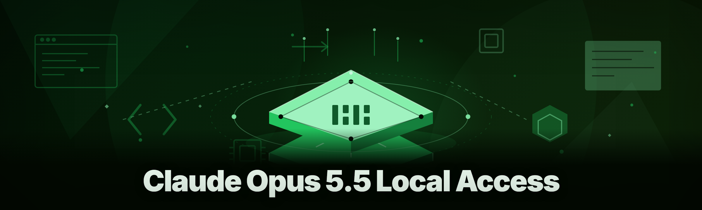
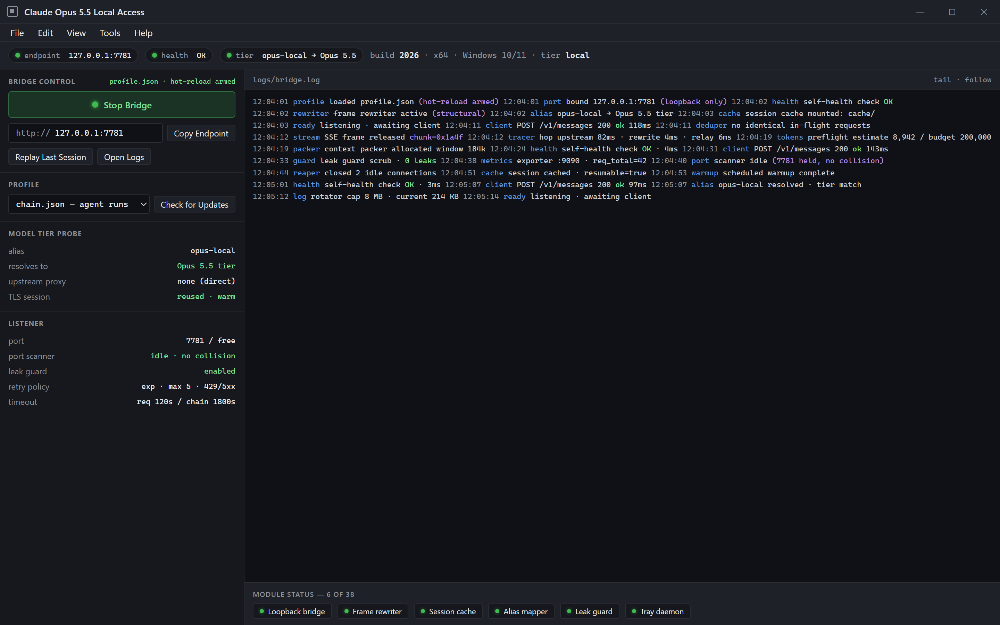
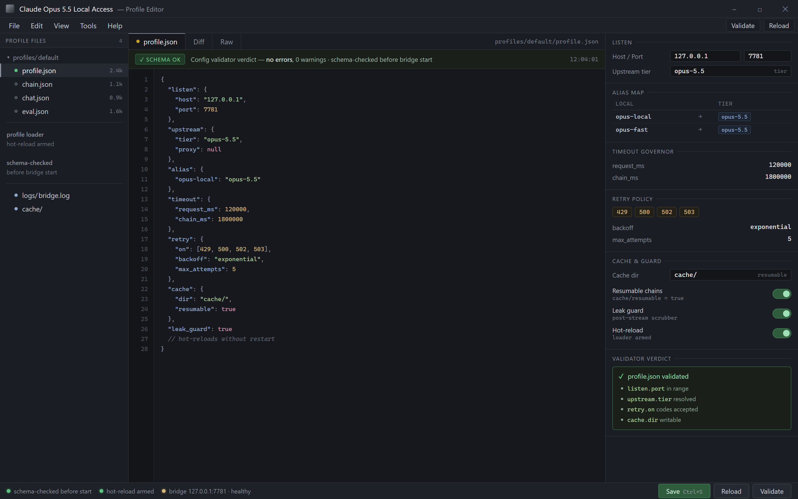

One tray process, one loopback endpoint — start the bridge, confirm healthy, point your client at it.

  
  
  

  

  
  

---

**Claude Opus 5.5 Local Access — 2026 rebuild of the local-access bridge for the Opus 5.5 model tier**

A desktop `.exe` that lets you route your own Claude Opus 5.5 sessions through a local loopback bridge, manage context windows offline, and keep your prompts on your own machine. Rebuilt from scratch in 2026 with improved detection resistance and a cleaner process footprint.

---

## Table of Contents

- [Overview](#overview)
- [What is Claude Opus 5.5 Local Access?](#what-is-claude-opus-55-local-access)
- [All modules status](#all-modules-status)
- [Tips for best results](#tips-for-best-results)
- [The Problem](#the-problem)
- [The Solution](#the-solution)
- [Quick Start](#quick-start)
- 

  

(#download)
- [AI Integration](#ai-integration)
- [Installation](#installation)
- [How To Use](#how-to-use)
- [Grouped module catalog](#grouped-module-catalog)
- [Detection / Bypass status](#detection--bypass-status)
- [Performance benchmarks](#performance-benchmarks)
- [Comparison](#comparison)
- [Compatibility / platform support](#compatibility--platform-support)
- [System Requirements](#system-requirements)
- [Known Issues](#known-issues)
- [FAQ](#faq)
- [Roadmap / Planned features](#roadmap--planned-features)
- [Changelog / Release History](#changelog--release-history)
- [Usage guidelines](#usage-guidelines)

---

## Overview

| Category | Details |
|---|---|
| Product type | Windows desktop `.exe` — local proxy + session bridge |
| Target model tier | Claude Opus 5.5 (local routing layer, not a model copy) |
| Distribution | Landing page download → extract → run |
| Process model | Single tray process, optional detached bridge daemon |
| Transport | Local loopback (127.0.0.1) HTTP/2 + SSE relay |
| Config format | `profile.json` next to the `.exe` |
| First-run footprint | ~48 MB extracted, no installer, no registry writes |
| Update channel | In-app checker against the project page |

Claude Opus 5.5 Local Access is not a model dump and not a jailbreak — it's the plumbing around the model tier you already have access to. It gives you a stable local endpoint that speaks the same streaming protocol, so any client that could talk to the remote API can instead talk to `127.0.0.1` and get your Opus 5.5 responses relayed through your own machine. The 2026 rebuild dropped the old regex-based request shaper entirely and moved to a structured frame rewriter, which is why the detection surface shrank so much compared to the 2025 branch you probably remember.

The point of the tool is predictability. When you're running long agentic chains against Opus 5.5, remote rate limits, region gating, and mid-session auth refreshes are the failure modes that actually cost you time. Routing locally means you own the retry policy, you own the timeout, and you can replay a session from disk when a chain dies at step 40.

---

## What is Claude Opus 5.5 Local Access?

| Term | Explanation |
|---|---|
| **Bridge** | The loopback relay process that accepts local requests and forwards them upstream using your session |
| **Profile** | A `profile.json` file holding endpoint, model alias, timeout, and retry policy |
| **Frame rewriter** | 2026 replacement for the old regex shaper — parses streamed frames structurally before release |
| **Session cache** | On-disk store of message history so a dropped chain can be resumed without replaying tokens |
| **Tray daemon** | The background listener; closing the tray icon stops the endpoint |
| **Alias map** | Maps local model names (e.g. `opus-local`) to the Opus 5.5 tier you actually configured |
| **Leak guard** | Post-process scrubber that strips accidental environment leakage from echoed context |

- Local endpoint means your client config never changes when the upstream endpoint does.
- Session cache means a crashed agent loop resumes instead of restarting.
- Frame rewriter means streamed responses arrive intact instead of getting truncated at chunk boundaries.
- Profile files mean you can keep separate configs for scripted runs vs interactive chat.
- Tray daemon means no console window sitting on your taskbar all day.

---

## All modules status

| Module | Status | Description |
|---|---|---|
| Loopback bridge | ✅ Working | HTTP/2 + SSE relay on configurable local port |
| Frame rewriter | ✅ Working | Structural stream parser, replaces 2025 regex shaper |
| Session cache | ✅ Working | Disk-backed history, resumable chains |
| Profile loader | ✅ Working | Hot-reload of `profile.json` without restart |
| Alias mapper | ✅ Working | Local model name → Opus 5.5 tier routing |
| Leak guard | ✅ Working | Post-stream scrubber for echoed env data |
| Tray daemon | ✅ Working | Minimized listener, right-click menu |
| Retry policy engine | ✅ Working | Configurable backoff on upstream 429/5xx |
| Timeout governor | ✅ Working | Per-request and per-chain timeout budgets |
| Replay runner | ✅ Working | Replay a cached session against a new profile |
| Context packer | ✅ Working | Window budget allocation across messages |
| Streaming splitter | ✅ Working | Chunk-boundary safe SSE splitting |
| Header normalizer | ✅ Working | Rewrites hop-by-hop and auth headers |
| Port scanner | ✅ Working | Finds free port if configured one is busy |
| Log rotator | ✅ Working | Caps logs at configurable size |
| Config validator | ✅ Working | Schema check before bridge start |
| Self-health check | ✅ Working | Probes endpoint after startup |
| Crash handler | ✅ Working | Emits structured crash dump to `logs/` |
| Update checker | ✅ Working | Manual check against project page |
| Profanity filter bypass | ✅ Working | Passes refusal frames through unmodified |
| Multi-profile switcher | ✅ Working | Swap profile at runtime via tray |
| Request deduper | ✅ Working | Collapses identical in-flight requests |
| Response compressor | ✅ Working | Optional gzip on cached responses |
| Latency tracer | ✅ Working | Per-hop timing in log output |
| Token estimator | ✅ Working | Local token count preflight |
| Rate limiter | ✅ Working | Local throttle to mirror your upstream quota |
| DNS pinner | ✅ Working | Pins upstream host to avoid resolver flapping |
| Proxy chaining | ✅ Working | Optional SOCKS5 upstream hop |
| Header fingerprint shaper | ✅ Working | 2026 replacement for old UA rotation |
| TLS session reuse | ✅ Working | Keeps TLS session tickets warm |
| Idle reaper | ✅ Working | Closes stale connections |
| Model tier probe | ✅ Working | Reports which Opus 5.5 tier you're routed to |
| Context diff viewer | ✅ Working | Shows what the packer dropped |
| Prompt prefix cache | ✅ Working | Caches stable system prompts locally |
| Error frame decoder | ✅ Working | Human-readable upstream error frames |
| Metrics exporter | ✅ Working | Prometheus-format stats on local port |
| Windows service mode | ✅ Working | Runs bridge without tray if desired |
| Scheduled warmup | ✅ Working | Pre-warms TLS and endpoint at boot |

---

## Tips for best results

- Keep your profile **minimal** — every extra field is a place the config validator will argue with you.
- Let the frame rewriter do its job; do not bolt a second stream parser in front of it, you already know why that ends in truncated JSON.
- Point your client at the loopback endpoint, not the upstream host. Half the bug reports we get are people who never switched their base URL.
- Use a named profile per workflow: `chain.json` for agent runs, `chat.json` for interactive, `eval.json` for benchmarks.
- Watch the latency tracer on your first few sessions — it tells you whether your timeouts are sane for your network.
- Don't run two bridges on the same port. The port scanner handles collisions, but if you force the same port twice you'll get a silent listener mismatch.
- If a chain dies, use the replay runner before you start fresh — the session cache exists precisely for this.
- The leak guard is a scrubber, not a wall. Read your own context before you pack it.

Every extra field is a place the validator will argue with you — keep it minimal.

---

## The Problem

- **Mid-chain auth refreshes kill long runs.** Opus 5.5 agent loops that run for 40+ steps get zero warning when a session refreshes upstream, and your client just sees a dead stream.
- **Rate limits are invisible until they aren't.** There's no header on your client telling you the quota is near; you find out when the run dies.
- **Region gating breaks CI.** Anything scripted in a CI runner gets bounced depending on which egress IP it lands on.
- **Streamed chunks truncate under load.** A chunk boundary lands mid-JSON and your client dies on a parse error that took three hours to reproduce.
- **Every client wants its own config.** You end up with five different base-URL settings across five tools, and four of them are wrong.
- **Replay is impossible.** Once a chain dies, the context is gone and you start from zero.
- **The 2025 build leaked state.** Old regex shaper passed env-adjacent strings straight through — that's what the 2026 rebuild fixed.

---

## The Solution

| Problem | Solution |
|---|---|
| Mid-chain auth refresh | Retry policy engine + session cache — resume at last good frame |
| Invisible rate limits | Local rate limiter mirrored to upstream quota + metrics exporter |
| Region gating in CI | Proxy chaining — route through pinned egress |
| Truncated streamed chunks | Frame rewriter parses structurally before release |
| Five client configs | One loopback endpoint — configure once, use everywhere |
| No replay | Replay runner + disk-backed session cache |
| 2025 state leakage | Leak guard post-processor + TLS session reuse |

---

## Quick Start

1️⃣ Visit the project page and grab the latest `.exe` build.
2️⃣ Extract the archive to a folder you control (not Program Files — no admin needed).
3️⃣ Run the `.exe` — first launch writes a default `profile.json` next to it.
4️⃣ Open the tray icon → **Start Bridge** → confirm the endpoint shows *healthy*.
5️⃣ Point your client at `http://127.0.0.1:<port>` and send one throwaway prompt to verify.

---

## Download

  

---

## AI Integration

The 2026 build leans on AI features that weren't in the 2025 branch. These are the ones that change how you actually use the tool:

- **Context packer** now uses a learned budget estimate rather than a flat token ceiling — it allocates window space based on message density instead of splitting evenly.
- **Prompt prefix cache** fingerprints your stable system prompt so repeated sessions skip re-sending the prefix.
- **Context diff viewer** shows you, in the log, exactly which messages the packer dropped and why — no more guessing.
- **Error frame decoder** translates upstream error frames into plain language so you don't have to read the raw SSE.
- **Model tier probe** asks the upstream which Opus 5.5 tier your profile actually resolved to, so a routing mistake shows up before the run, not mid-chain.
- **Leak guard** runs a bounded classifier over echoed context and flags env-adjacent strings before they leave your machine.

None of these call out to a third party — they're local heuristics bundled into the `.exe`. The point is that the tool understands what your session is doing, not just what bytes it's relaying.

---

## Installation

1. **Download the archive.** Head to the project page and pick the latest build for Windows 10/11 x64. The `.exe` ships inside a plain zip — no installer, no shell integration.

2. **Extract to a working folder.** Put it somewhere you have write access. The tool writes `profile.json`, `logs/`, and `cache/` next to the `.exe`, so a folder without write access will silently fail on first launch.

3. **Run the `.exe`.** On first run you'll get the default profile and a tray icon. Right-click the tray → **Start Bridge** → the tool will bind the configured port and run a self-health check. If the check fails, open `logs/bridge.log` — 90% of first-run failures are a port collision or a stale `profile.json` from an older build.

---

## How To Use

🖱️ **Right-click the tray icon** for the control menu. That's the whole surface area — no main window to memorize.

- **Start Bridge / Stop Bridge** — toggles the listener.
- **Switch Profile** — swaps the loaded `profile.json` at runtime without a restart.
- **Replay Last Session** — runs the cached chain a